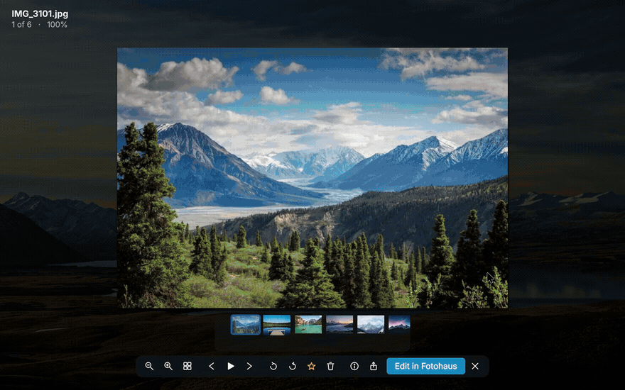
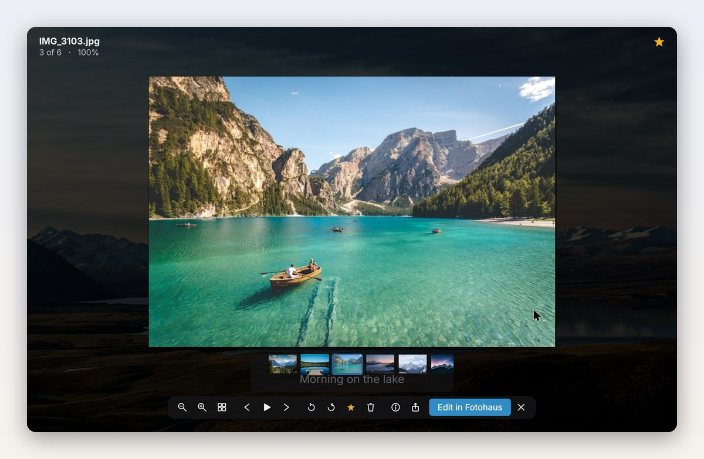
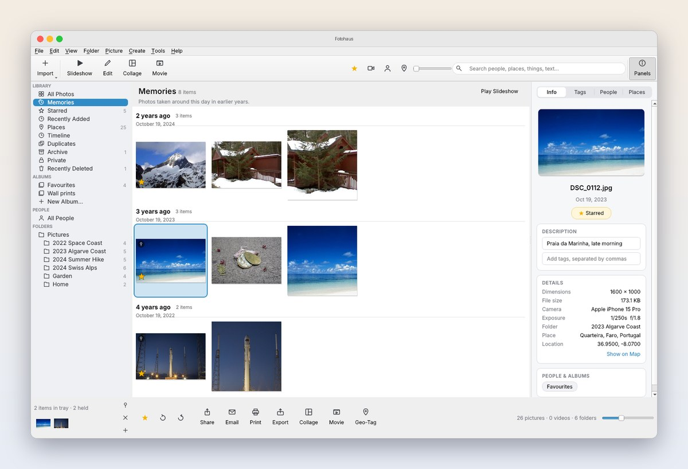
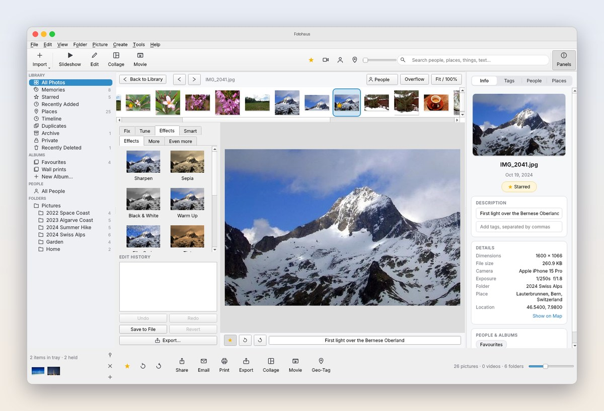

<div align="center">

# Fotohaus

**Your photos. Your computer. Nobody else's business.**

A fast, private photo viewer and organizer for **Mac, Windows and Linux** that finds faces,
searches your photos, edits without touching your originals, and never uploads a single pixel.

[](#install)
[](#install)
[](#install)
[](LICENSE)
[](https://buymeacoffee.com/aelnagish)

**[Website](https://aelnagish.github.io/Fotohaus/)** · **[Download](https://github.com/aelnagish/Fotohaus/releases/latest)** · **[Install guide](INSTALL.md)**



</div>

---

*Fotohaus*: one home for every picture you've ever taken.

Point it at the folders already on your computer, and in a few minutes years of photos are sorted,
searchable and easy to show off. Nothing is copied into a hidden library and nothing leaves your
computer. Your files stay exactly where they are.

## Why Fotohaus

- **Private by design.** Face recognition, search and editing all run on your computer. No
  account, no cloud, no tracking.
- **Your folders, untouched.** No import into a hidden library. Fotohaus works on the folders you
  already have, and every edit is reversible.
- **Fast.** Open a photo from Finder or File Explorer and it appears instantly over your desktop,
  with the rest of the folder one arrow key away.
- **Clever where it counts.** Search for "dog on the beach", "receipt" or a friend's name and get
  answers, not filenames.
- **One app, three systems.** The same Fotohaus runs on Mac, Windows and Linux, so your library
  habits move with you.

## Flip through a folder in a blink

Double-click any photo in Finder or File Explorer and it opens instantly over your desktop. Then just press
**←** and **→** to glide through every other photo in the same folder. No importing, no waiting,
no library to set up first. Zoom with the scroll wheel, star or rotate as you go, and press
**Esc** to get back to what you were doing.

<div align="center">

</div>

## On this day

Each day Fotohaus looks back through your library for pictures taken on today's date in
earlier years, and gathers them into **Memories**: "2 years ago", "3 years ago", ready to play as a
slideshow. Each photo also knows where it was taken ("Lauterbrunnen, Bern, Switzerland"), worked out
on your computer from a built-in atlas, so you can simply search for a town.

<div align="center">

</div>

## Some photos are just for you

Select pictures and choose **Move to Private**. They vanish from the library, search, Memories,
People and Places, and the **Private** collection opens only with **Touch ID** on a Mac,
**Windows Hello** on Windows, or a password you set on Linux. It locks again when you quit.

Two quieter places help keep the library tidy:

- **Archive** tucks away screenshots, receipts and the photos you want to keep but not see every
  day. They stay on disk and come back with one click.
- **Recently Deleted** holds anything you delete in the library for **30 days**, so a slip of the
  finger is never final. Only then do files move to the Trash (the Recycle Bin on Windows). In the
  Photo Viewer, Delete sends the photo straight there, with a moment to **Undo**.

## Find anyone, and anything

Name a face once and Fotohaus suggests the same person across the years, all on your computer.
Search understands people, places, tags and dates (`person:anna place:zermatt year:2019`) and,
with the optional search model, plain descriptions like "kids playing in the snow". On a Mac it
also knows the objects and scenes in a photo ("dog", "beach") and the **words in it**: type
"invoice" or a street sign and find the picture.

## Bursts, RAW pairs and Live Photos, tidied up

A burst of twelve near-identical shots, the RAW and JPEG of the same moment, the short video
behind an iPhone Live Photo: Fotohaus folds each into one **stack** with a small badge, so the
library shows moments, not clutter. Open a Live Photo and press **L** to see it move.

## Bring your old library along

Have folders an older photo organizer has looked after for years? Fotohaus reads the `.picasa.ini`
files sitting next to your photos, so your stars, captions, albums, face tags and edits come
straight back. It keeps writing them too, so nothing is locked in.

## What it does

<table>
<tr>
<td width="50%" valign="top">

### Organize
- Library grouped by folder and date, with stars, captions, tags and albums
- **Photo Tray**: hold pictures from different folders and act on them together
- Timeline and **Places** map with real place names ("Zermatt, Switzerland"), worked out offline
- **Memories**: "On this day" photos from earlier years, right at the top of your library
- **Stacks**: RAW+JPEG pairs, bursts and Live Photos fold into one thumbnail
- **Archive**, a Touch ID-locked **Private** collection, and **Recently Deleted** (30 days to change your mind)
- Folder tools: rename, move, split, hide, batch rename, fix dates
- Import from cameras and cards, skipping duplicates

</td>
<td width="50%" valign="top">

### Find
- **Faces**: on-device detection and recognition. Name someone once and Fotohaus suggests the rest
- Optional natural-language search ("kids playing in the snow"), on every system
- **Smart search** for objects, scenes and text inside photos (Mac, using Apple's on-device Vision)
- Duplicate and near-duplicate finder that keeps the best copy
- Nested tags like `Trips/2024/Alps`, browsable as a tree

</td>
</tr>
<tr>
<td valign="top">

### Edit
- One-click fixes: auto enhance, contrast, colour, straighten, crop, red-eye
- Fine tuning for light, shadows, highlights and colour temperature
- More than 40 creative effects, plus retouch, text, smart enhance, denoise and clarity
- Non-destructive: originals are kept and every edit can be undone
- Copy and paste a whole look onto other photos, or batch edit at once

</td>
<td valign="top">

### Share and create
- Collages (six styles), slideshows, and **movies with music**
- Posters, contact sheets, passport photos, and print or PDF
- Web gallery export, map export, email, and the Share menu on a Mac
- Backups to any drive, with incremental updates and restore

</td>
</tr>
</table>

<div align="center">

</div>

**Reads what your camera writes:** JPEG, HEIC/HEIF, AVIF, PNG, TIFF, WebP, GIF, PSD, camera RAW
(CR2, CR3, NEF, ARW, DNG, RAF and more) and common video formats, colour-managed for accurate
display. Captions and tags can be written into the files themselves, so other apps see them too.

**Comes with a command line, too.** `fotohaus-cli search "beach 2019"` searches from the Terminal,
and `fotohaus-cli mcp` lets AI assistants that support MCP search and organize your library.

## Install

Download the latest version from [Releases](../../releases/latest). The step-by-step guide for each
system, including the command line, the Claude (MCP) setup and how to uninstall, is in
[INSTALL.md](INSTALL.md).

| System | Download | Needs |
|---|---|---|
| **Mac** | `Fotohaus-1.0.2-arm64.dmg` | Apple Silicon (M1 or newer), macOS 14 Sonoma or newer |
| **Windows** | `Fotohaus-1.0.2-Setup.exe` | 64-bit Windows 10 or 11 |
| **Linux** | `Fotohaus-1.0.2-x86_64.AppImage` | 64-bit, glibc 2.28 or newer (Ubuntu 20.04, Debian 10, Fedora 29 and later) |

### Mac

**With Homebrew** (opens without the first-launch warning, and adds `fotohaus-cli`):

```bash
brew install --cask aelnagish/tap/fotohaus
```

**Or from the disk image:** open it and drag **Fotohaus** into **Applications**. Fotohaus isn't
notarized by Apple yet, so macOS blocks it the first time:

- If macOS says it **"is damaged and can't be opened"**, click *Cancel* (not *Move to Trash*).
  Nothing is wrong with the app. Open **Terminal**, run this once, then open Fotohaus again:

  ```bash
  xattr -cr /Applications/Fotohaus.app
  ```

- If it says it **"could not verify"** Fotohaus, open *System Settings ▸ Privacy & Security*,
  scroll down and click **Open Anyway**.

### Windows

Run the installer. It needs no administrator rights. Until the installer is code-signed, Windows
shows **"Windows protected your PC"** the first time: click **More info**, then **Run anyway**.

### Linux

Make the AppImage executable (`chmod +x Fotohaus-*.AppImage`, or *Properties ▸ Allow executing as
program*) and double-click it.

To open photos in Fotohaus when you double-click them, on any system, use
*Tools ▸ Options ▸ Photo Viewer*.

### Run from source

```bash
./run.sh                     # first run sets everything up, then opens the app
# or manually:
python3 -m venv .venv && source .venv/bin/activate
pip install -r requirements.txt
python -m fotohaus            # app
python -m fotohaus.cli --help # command line
```

Python 3.11 or newer (3.12 is what the builds use) works on all three systems (on Windows, use `py -m venv .venv` and
`.venv\Scripts\activate`). The library database lives in `~/Library/Application Support/Fotohaus`
on a Mac, `%LOCALAPPDATA%\Fotohaus` on Windows and `~/.local/share/fotohaus` on Linux (set
`FOTOHAUS_HOME` to use a different place). Run the tests with `pip install -r requirements-dev.txt`, then `python tests/test_fotohaus.py` and
`python tests/test_review.py`. To build the apps yourself, see
`packaging/build_mac_app.py`, `packaging/build_windows.py` and `packaging/build_linux.py`.

## Support

Fotohaus is free, built to make everyday things a little easier. If it saved you an
afternoon of sorting photos, you can [buy me a coffee ☕](https://buymeacoffee.com/aelnagish).

Bug reports and ideas are welcome in [Issues](../../issues). Pull requests are covered by
[CONTRIBUTING.md](CONTRIBUTING.md).

## License

Fotohaus is free software, licensed under the **GNU General Public License, version 3 or later**
(see [LICENSE](LICENSE)). You may use, study, share and change it; if you distribute it, modified
or not, you must pass on the same freedoms and the source code. Copyright © 2026 Abdullah Yusuf.

The apps bundle third-party software and data under their own licenses, listed in
[`packaging/THIRD_PARTY_NOTICES.md`](packaging/THIRD_PARTY_NOTICES.md) and in the Licenses folder
that comes with each app. Among them: place names from [GeoNames](https://www.geonames.org)
(CC BY 4.0), map tiles from [OpenStreetMap](https://www.openstreetmap.org/copyright) contributors,
and face models from [OpenCV Zoo](https://github.com/opencv/opencv_zoo). The source code of the GPL
libraries inside the apps (such as FFmpeg, x264 and x265) is attached to each release as
`fotohaus-1.0.2-gpl-sources.tar`.

Fotohaus is an independent project and is not affiliated with or endorsed by Apple, Google or
Microsoft. All product names mentioned are trademarks of their owners.

<sub>Screenshots and the demo use sample images from the imageio and Pillow projects and landscape
photos from [Unsplash](https://unsplash.com), used under the
[Unsplash License](https://unsplash.com/license).</sub>
