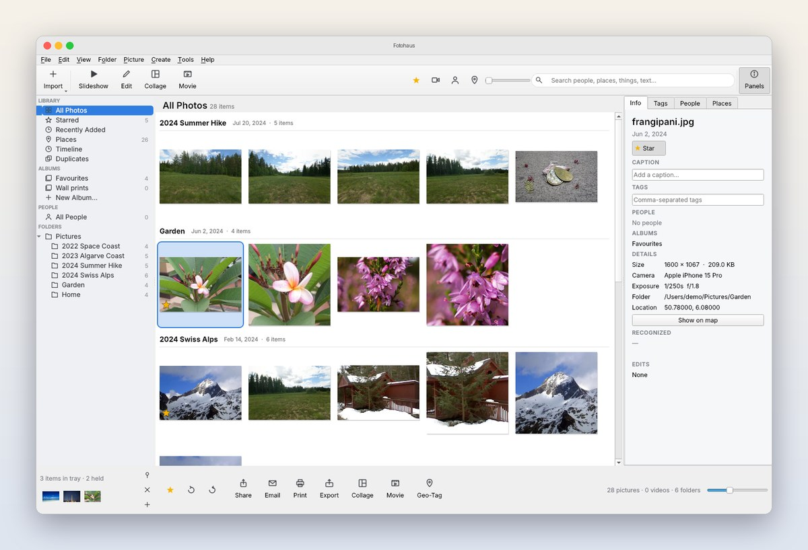
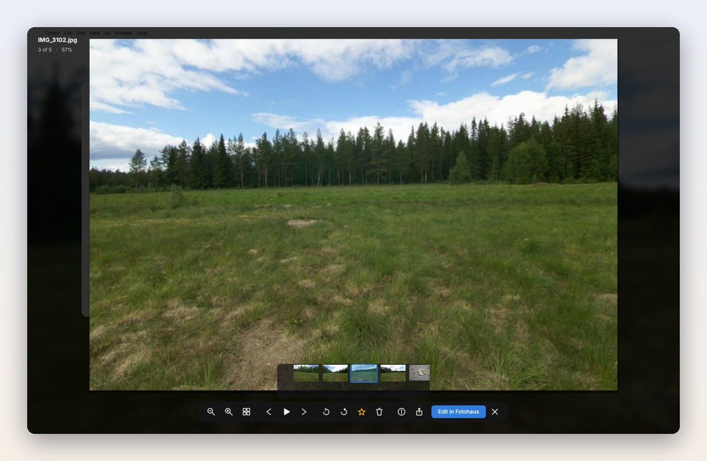
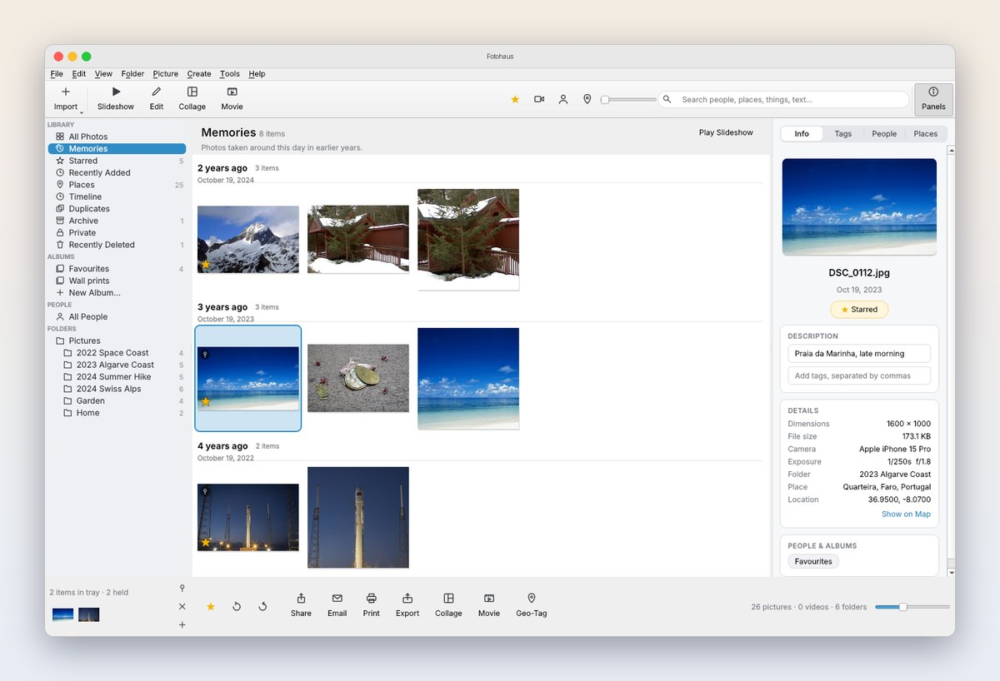
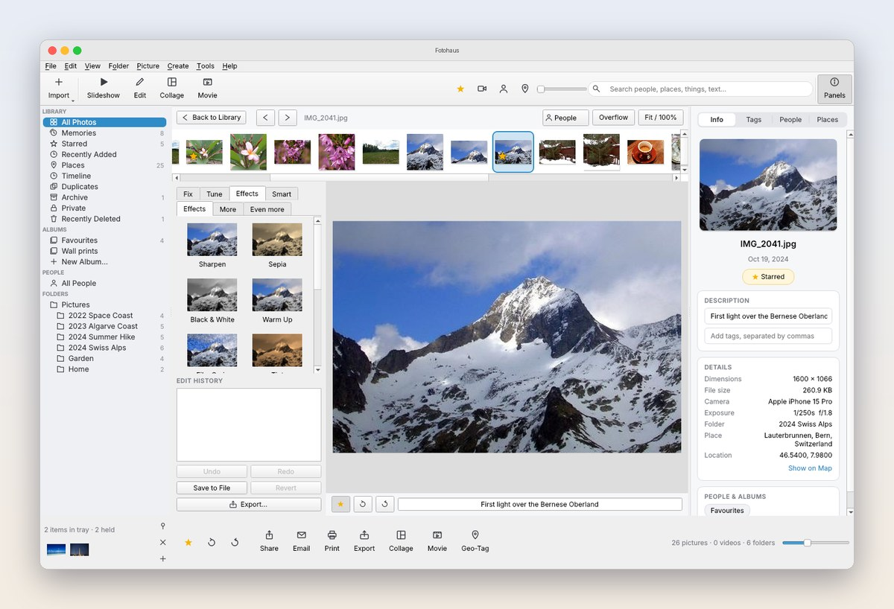

<div align="center">

# Fotohaus

**Your photos. Your Mac. Nobody else's business.**

A fast, private photo organizer for macOS that finds faces, reads text in photos, edits without
touching your originals, and never uploads a single pixel.

[](#install)
[](LICENSE)
[](https://buymeacoffee.com/aelnagish)



</div>

---

*Fotohaus*: one home for every picture you've ever taken.

Point it at the folders already on your Mac, and in a few minutes years of photos are sorted,
searchable and easy to show off. Nothing is copied into a hidden library and nothing leaves your
computer. Your files stay exactly where they are.

## Why Fotohaus

- **Private by design.** Face recognition, search and editing all run on your Mac. No account,
  no cloud, no tracking.
- **Your folders, untouched.** No import into a hidden library. Fotohaus works on the folders you
  already have, and every edit is reversible.
- **Fast.** Open a photo from Finder and it appears instantly over your desktop, with the rest of
  the folder one arrow key away.
- **Clever where it counts.** Search for "dog on the beach", "receipt" or a friend's name and get
  answers, not filenames.

## Flip through a folder in a blink

Double-click any photo in Finder and it opens instantly over your desktop. Then just press
**←** and **→** to glide through every other photo in the same folder. No importing, no waiting,
no library to set up first. Zoom with the scroll wheel, star or rotate as you go, and press
**Esc** to get back to what you were doing.

<div align="center">

</div>

## On this day

Each day Fotohaus looks back through your library for pictures taken on today's date in
earlier years, and gathers them into **Memories**: "2 years ago", "3 years ago", ready to play as a
slideshow. Each photo also knows where it was taken ("Lauterbrunnen, Bern, Switzerland"), worked out
on your Mac from a built-in atlas, so you can simply search for a town.

<div align="center">

</div>

## What it does

<table>
<tr>
<td width="50%" valign="top">

### Organize
- Library grouped by folder and date, with stars, captions, tags and albums
- **Photo Tray**: hold pictures from different folders and act on them together
- Timeline and **Places** map with real place names ("Zermatt, Switzerland"), worked out offline
- **Memories**: "On this day" photos from earlier years, right at the top of your library
- **Stacks**: RAW+JPEG pairs, bursts and Live Photos fold into one thumbnail
- **Archive**, a Touch ID-locked **Private** collection, and **Recently Deleted** (30 days to change your mind)
- Folder tools: rename, move, split, hide, batch rename, fix dates
- Import from cameras and cards, skipping duplicates

</td>
<td width="50%" valign="top">

### Find
- **Faces**: on-device detection and recognition. Name someone once and Fotohaus suggests the rest
- **Smart search** for objects, scenes and text inside photos, using Apple's on-device Vision
- Optional natural-language search ("kids playing in the snow")
- Duplicate and near-duplicate finder that keeps the best copy
- Nested tags like `Trips/2024/Alps`, browsable as a tree

</td>
</tr>
<tr>
<td valign="top">

### Edit
- One-click fixes: auto enhance, contrast, colour, straighten, crop, red-eye
- Fine tuning for light, shadows, highlights and colour temperature
- More than 40 creative effects, plus retouch, text, smart enhance, denoise and clarity
- Non-destructive: originals are kept and every edit can be undone
- Copy and paste a whole look onto other photos, or batch edit at once

</td>
<td valign="top">

### Share and create
- Collages (six styles), slideshows, and **movies with music**
- Posters, contact sheets, passport photos, and print or PDF
- Web gallery export, map export, email and the macOS Share menu
- Backups to any drive, with incremental updates and restore

</td>
</tr>
</table>

<div align="center">

</div>

**Reads what your camera writes:** JPEG, HEIC/HEIF, AVIF, PNG, TIFF, WebP, GIF, PSD, camera RAW
(CR2, CR3, NEF, ARW, DNG, RAF and more) and common video formats, colour-managed for accurate
display. Captions and tags can be written into the files themselves, so other apps see them too.

**Coming from Picasa?** Fotohaus reads and writes `.picasa.ini` files, so your stars, captions,
albums, face tags and edits come straight across.

**Comes with a command line, too.** `fotohaus-cli search "beach 2019"` searches from the Terminal,
and `fotohaus-cli mcp` lets AI assistants that support MCP search and organize your library.

## Install

1. Download `Fotohaus-1.0.0-arm64.dmg` from [Releases](../../releases) (Apple Silicon Macs).
2. Open the disk image and drag **Fotohaus** into **Applications**.
3. Open Fotohaus. Because it isn't notarized by Apple yet, macOS blocks it the first time: open
   *System Settings ▸ Privacy & Security*, scroll down and click **Open Anyway** next to the
   message about Fotohaus. You only need to do this once.
4. To open photos in Fotohaus when you double-click them, use *Tools ▸ Options ▸ Photo Viewer*.

### Run from source

```bash
./run.sh                     # first run sets everything up, then opens the app
# or manually:
python3 -m venv .venv && source .venv/bin/activate
pip install -r requirements.txt
python -m fotohaus            # app
python -m fotohaus.cli --help # command line
```

Your library database lives in `~/Library/Application Support/Fotohaus` (set `FOTOHAUS_HOME` to use
a different place). Run the tests with `pip install -r requirements-dev.txt && python tests/test_fotohaus.py`. To build the app and disk
image, see `packaging/build_mac_app.py`.

## Support

Fotohaus is a free side project, built to make everyday things a little easier. If it saved you an
afternoon of sorting photos, you can [buy me a coffee ☕](https://buymeacoffee.com/aelnagish).

Bug reports and ideas are welcome in [Issues](../../issues). Pull requests are covered by
[CONTRIBUTING.md](CONTRIBUTING.md).

## License

Fotohaus is free software, licensed under the **GNU General Public License, version 3 or later**
(see [LICENSE](LICENSE)). You may use, study, share and change it; if you distribute it, modified
or not, you must pass on the same freedoms and the source code. Copyright © 2026 Abdullah Yusuf.

The app bundles third-party components under their own licenses, listed in
[`packaging/THIRD_PARTY_NOTICES.md`](packaging/THIRD_PARTY_NOTICES.md). The source code of the
GPL libraries inside the app (FFmpeg, x264, x265) is attached to each release.

<sub>Screenshots use freely licensed sample images from the scikit-image, imageio and Pillow
projects. Fotohaus is an independent project.</sub>
